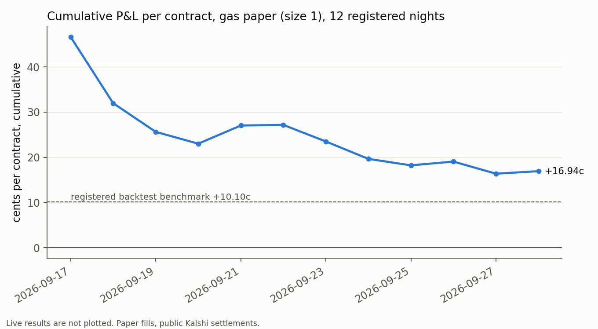
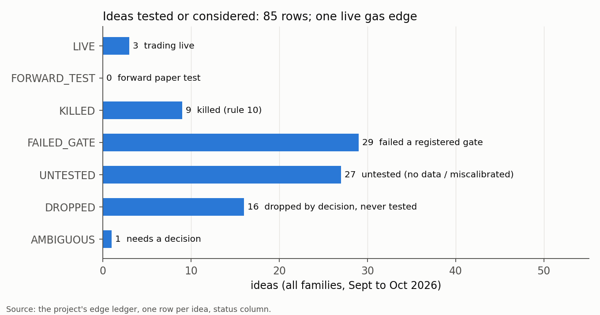
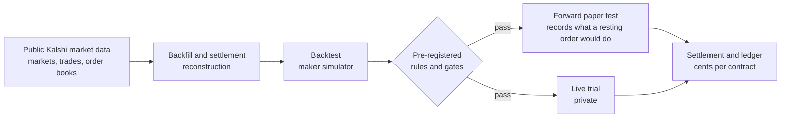

# Kalshi Gas Market-Maker: from hypothesis to live trading

An automated trading system for Kalshi's daily US gas-price markets. It went through a pre-registered backtest, a forward paper test, and a small live trial. 1 of 85 strategy ideas survived; this repo documents the one that did and why the others didn't.

**At a glance**
- **+16.9¢ per contract** after fees in a 12-night forward paper test (3,270 fills, 72% profitable)
- **+10.1¢ per contract** in the pre-registered backtest (67 days, 14,213 simulated fills)
- **38 ideas killed** by pass/fail rules written *before* each test ran
- Deployed live at minimum size (Sept 2026). I paused live trading on 2026-10-29.



## The edge in plain English

Kalshi lists a ladder of contracts each day: "Will the AAA national gas average be above $X tomorrow?" In the last hours before the 11:59 PM ET close, buyers of **YES** pay more than those contracts turn out to be worth on average. The system posts resting offers to sell YES at those prices. About 72% of the contracts it sold settled **NO**, so the offer kept its premium.

It never takes the other side's price (it only rests offers), and every result is measured after Kalshi's fee.

## Results

Figures are cents per contract after Kalshi's taker fee. Full detail in [RESULTS.md](RESULTS.md).

| Measure | Result |
|---|---|
| Backtest, pre-registered benchmark (67 days, 14,213 simulated fills) | **+10.10¢**, 95% interval +4.28 to +16.15* |
| Forward paper test (12 evenings, 3,270 simulated fills) | **+16.94¢**, 95% interval +4.75 to +27.85 |
| Paper fills that were profitable | 72.1% |
| Paper evenings that were positive | 8 of 12 |
| Ideas tested | 85 logged; 38 killed or failed a pre-registered gate |

\*Registered interval. An independent recomputation for this repo gives +4.18 to +16.07.

**Read with care:** paper results are simulated against recorded order books, not real execution, so they can overstate live results. Twelve evenings is a small sample, which is why the paper interval is wide. Live results are private and not claimed here.



## How the work was done

The method is the point of the project. Every idea goes through the same gates:

1. **Write the rule first.** Hypothesis, data split, statistics and pass/fail threshold are committed before any result is computed.
2. **Backtest on history** the rule was not tuned on.
3. **Forward paper test** on live market data, with a stop rule fixed in advance.
4. **Go live small.** Money goes in only after a paper pass, at minimum size.
5. **A failed gate is a failure.** Thresholds are never moved after a result is known.

## What failed, and what I learned

Most ideas died. The failures taught the most:

- A forecasting model built on wholesale gasoline prices (RBOB) **lost to the market's own pricing** at every time of day checked.
- Filters on which strikes to quote, capital-allocation rules, and start-time changes **all failed confirmation**.
- State-level gas markets and a temperature-market version of the idea **produced no edge**.

Lessons:

- **Rank ideas by what they earn at settlement, not by bid-ask spread.** Screening on spread would have thrown away the one edge that worked.
- **An observed trade is not a fill.** The backtest simulates whether a resting order could actually have been filled, which changed several results.
- **Resample by day, not by trade.** Trades on the same day move together; treating them as independent makes results look far more certain than they are.
- **Both halves must agree.** A result that is positive overall but negative in one half of the data is not an edge.
- **Check the plumbing.** A ledger bug silently skipped compressed data files, and a floating-point rounding error halted live trading on night three. Both were caught and fixed; every headline number here was re-checked against raw files.

## Timeline

| Date (2026) | Milestone |
|---|---|
| Sep 16 | Kill rule registered before the first paper quote; paper test starts |
| Sep 17 | Survey: the evening edge exists on no other daily Kalshi market |
| Sep 22 | Model-based forecast loses to the market; refuted |
| Sep 24 | First live night at minimum size |
| Sep 26 | Rounding-error halt fixed with exact decimal arithmetic |
| Sep 27–29 | Filter, capital-cap, start-time and state-market studies: nothing passes |
| Sep 28 | Live trading pre-registered to mirror the paper strategy exactly |
| Oct 16 | Sister market (diesel) passes its first live gate (+4.19¢ over 323 fills) |
| Oct 21 | Full scan of daily markets: no second gas-like edge exists |
| Oct 26 | Research stack retired; project narrowed to gas and diesel |
| Oct 29 | I paused live trading |

## Architecture



## What's in this repository

Research code only, copied from the private project:

- `sports_terminal/gas/reconstruct.py`: recovers each day's published average price from how its strike ladder settled.
- `sports_terminal/gas/dataset.py`: one row per market-minute, keyed on distance from the strike.
- `sports_terminal/gas/analysis.py`: calibration, expected value by hour, date-level bootstrap.
- `sports_terminal/gas/maker.py`: the backtest's resting-order simulator.
- `sports_terminal/gas/paper.py`: the forward paper recorder. It places no orders.
- `sports_terminal/gas/ledger.py`: settles paper fills and applies the kill rule.
- `sports_terminal/gas/tape.py`: reads the hourly data files, including compressed ones.
- `sports_terminal/core/fees.py`: Kalshi's fee formula.

Files marked STUB or REIMPLEMENTATION replace private modules (`core/config.py`, `core/jsonlines.py`, `gas/schema.py`, `backfill/client.py`, `live/store.py`); each says what it replaces. Live execution code, the dashboard, deployment configuration and live data are private.

## Reproduce

```
pip install -r requirements.txt
python scripts/reproduce_headline.py
python -m pytest -q
```

Runs the same P&L method on five evenings of public sample data in `data/sample/` and checks each against its full-run figure. The 12-evening headline needs the complete tape, which is not published.

## How this was built

I designed the strategy, the experiments and the pass/fail rules, and reviewed every result against the raw data. The code was written with AI coding tools (Claude Code, Cursor).

**Abhinay Kadam** · BAIT @ Rutgers Business School '28 · [LinkedIn](https://www.linkedin.com/in/abhinay-kadam-8b660b32a)
