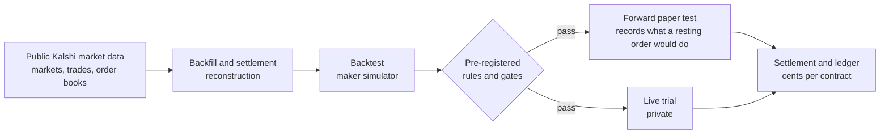

# Gas-price prediction-market research

## What it is

This project looks for small, verifiable trading edges in Kalshi's prediction markets, the
regulated US exchange where people trade on real-world outcomes. One edge, a market-making
rule on the US national gas-price market, passed a pre-registered backtest and a forward
paper test, then ran in a small live trial before live trading was halted on 2026-10-29.

**Live results and the live trading code are private** and are not in this repository.

## Headline results

Figures are cents per contract after Kalshi's taker fee. Full detail in [RESULTS.md](RESULTS.md).

| Measure | Result |
|---|---|
| Backtest, pre-registered benchmark (67 days, 14,213 simulated fills) | **+10.10c** per contract, 95% interval +4.18 to +16.07 |
| Forward paper test (12 evenings, 3,270 simulated fills) | **+16.94c** per contract, 95% interval +4.75 to +27.85 |
| Paper fills that were profitable | 72.1% |
| Paper evenings that were positive | 8 of 12 |
| Ideas tested | 85 logged; 38 killed or failed a pre-registered gate |

Paper results are simulated against recorded order books. They are not real execution, so
they can overstate what a live order would earn. The 12-evening paper figure is the strongest
number here and is also the one with the widest uncertainty.

## How the work was done

The method is the point of the project. Each idea goes through the same steps:

1. **Write the rule first.** The hypothesis, the data split, the statistics and the pass/fail
   threshold are written down and committed before any result is computed.
2. **Backtest on history.** The first test uses data the rule was not tuned on.
3. **Forward paper test.** The rule then runs on live market data, recording what it would
   have done, with a stop rule fixed in advance.
4. **Live, small.** Only after a paper pass does money go in, at minimum size.

A failed gate is recorded as a failure. Thresholds are not moved after a result is known.

## What failed, and what I learned

Most ideas died, and the failures taught the most:

- **A model built on the wholesale gasoline price** (RBOB) did not beat the market's own
  pricing. The market was sharper than the model at each of the three checked times of day.
- **Filters on which price levels to quote** all lost on the confirmation data.
- **Capital-allocation rules** (which strikes to fund, how much cap) changed almost nothing.
- **State-level gas ladders** produced no candidate once the sample was large enough.
- **A temperature-market version** of the same idea lost on every one of 38 cells.
- **Trade-flow following** and several weather strategies were closed as families.

What I took from it:

- **Settlement edge, not spread.** Ranking ideas by what they earn at settlement, not by
  the bid-ask spread, is what found the one edge that worked. Screening on spread would have
  thrown it away.
- **Test the window, not the clock.** The gas edge exists because the market closes at
  23:59 Eastern. That is a fact about one market's close, not a general time-of-day effect,
  so it needed its own test.
- **A backtest needs a reachability check.** An observed trade is not a fill. Simulating
  whether a resting order could actually have filled changed several results.
- **Resample by date.** Trades on the same day are correlated, so the interval has to
  resample whole days. Resampling trades makes the result look far more certain than it is.
- **Both halves must agree.** A result that is positive on the full sample but negative in
  one half is not an edge.
- **Harness bugs are real.** A ledger that quietly skipped compressed hour-files reported
  every fill at 23:00. A floating-point rounding error halted live trading. Every headline
  number here was re-checked against the raw files.

## Timeline

| date | milestone |
|---|---|
| 2026-09-16 | Kill rule registered before the first paper quote. Paper maker starts. |
| 2026-09-17 | Survey: the evening maker edge exists on no other daily ladder. |
| 2026-09-22 | Model-based forecast loses to the market. Refuted. |
| 2026-09-24 | Live engine, first minimum-size night. |
| 2026-09-26 | A rounding-error halt is fixed with exact decimal arithmetic. |
| 2026-09-27 | Filter study: nothing passes. |
| 2026-09-28 | Live mirror of paper size 1 pre-registered, with a stop rule. |
| 2026-09-29 | Capital-cap and start-time studies: no change. State ladders screened, no candidate. |
| 2026-10-04 | A second market (diesel) run live ahead of full evidence, by decision. |
| 2026-10-16 | Diesel passes its first-ten gate (+4.19c over 323 fills). |
| 2026-10-18 | Automatic loss stop retired, replaced by a manual pause switch. |
| 2026-10-20 | Trade-flow-following family closed. |
| 2026-10-21 | Gas-shape scan closes: no second gas edge on the daily board. |
| 2026-10-25 | Diesel live trading paused. |
| 2026-10-26 | Research stack retired; project reduced to gas and diesel. |
| 2026-10-29 | Live gas trading halted. |

Full detail, with the commits behind each row, is in the private project history.

## Architecture



## What is in this repository

Research code only, copied from the private project:

- `sports_terminal/gas/reconstruct.py`: recovers each day's published average price from how its strike ladder settled.
- `sports_terminal/gas/dataset.py`: one row per market-minute, keyed on distance from the strike.
- `sports_terminal/gas/analysis.py`: calibration, expected value by hour, date-level bootstrap.
- `sports_terminal/gas/maker.py`: the backtest's resting-order simulator (maker v2).
- `sports_terminal/gas/paper.py`: the forward paper recorder. It places no orders.
- `sports_terminal/gas/ledger.py`: settles paper fills and applies the kill rule.
- `sports_terminal/gas/tape.py`: reads the hourly data files, including compressed ones.
- `sports_terminal/core/fees.py`: Kalshi's fee formula.

Replacements, each marked `STUB` or `REIMPLEMENTATION` in its file:

- `core/config.py`: only the published fee defaults. The private version also reads environment settings.
- `core/jsonlines.py`: a tolerant JSON-lines reader without the health log.
- `gas/schema.py`: the series-name parser only. The private file defines the full Parquet schemas.
- `backfill/client.py`: a stub. The rate-limited live reader is not published, so the code paths that call it raise a clear error. The reproduction runs offline.
- `live/store.py`: a minimal writer for the paper recorder. The private version adds disk budgets and manifests.

Not included: live execution code, the dashboard, deployment configuration, and the research
log. Live execution code and live data are private.

## Reproduce

```
pip install -r requirements.txt
python scripts/reproduce_headline.py
python -m pytest -q
```

The reproduction runs the same P&L method on five evenings of public-market sample data in
`data/sample/`, and checks each evening against its full-run figure. The 12-evening headline
needs the complete tape, which is not published.

## How this was built

I designed the strategy, the experiments and the pass/fail rules. The code was written with
AI coding tools (Claude Code, Cursor).
